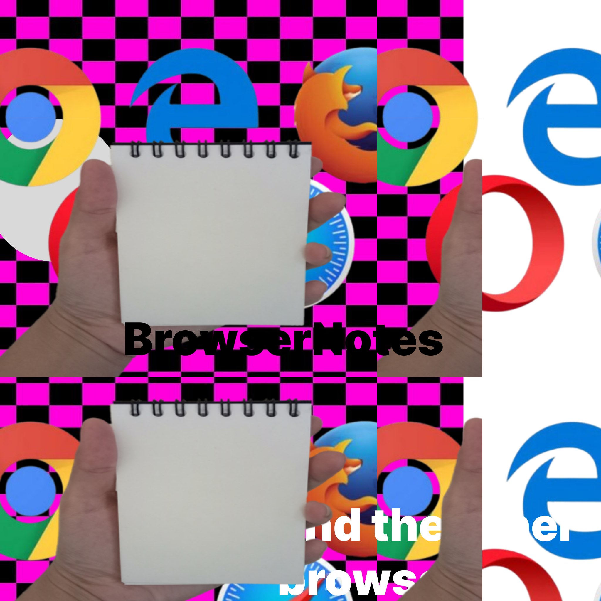

# BrowserNotes

> **Moved.** BrowserNotes is now [notes](https://kmads.dev/notes/) ([source](https://github.com/kmadsdev/notes)). <https://kmads.dev/browsernotes/> redirects there. The `data:` URLs below still work offline.

BrowserNotes is an extremely lightweight notepad app that runs offline directly in your browser.

 <-- our ballistic logo, I made it all by myself

## Website
1. Paste this URL in your browser (don't worry, it's not a malware, malware is actually useful).
2. Add as a bookmark, so you don't ever forget to appreciate the built-in notepad you have.
3. Enjoy. (I do not care if you don't)

It works offline, in your browser throught the link below, no servers, no host, 0% downtime (assuming you use linux, else you can die peacefully). Don't worry about the Google Font urls, your browser always have a font to use in case you're actually offline.
There is not persistant memory on this think, so it's literally the notes app you ALREADY have in your PC, but worse. Checkmate Elon Musk.

Good news: i could never charge anything for this "software", and so you are technically free to copy and host your own. Don't do it.
Bad news: the application itself is complete garbage, if you are able to get >$0,0000001 on THIS, please contact me immediately.

<br>

### ✒️𓂃 BrowserNote
```
data:text/html,<html contentUnEditable style="background-color:black;color:white;margin:0;padding:0;font-family:sans-serif;"><div style="display:flex;flex-direction:row;justify-content:center;align-items:center;padding:10px;"><h1>BrowserNotes</h1><span style="width:10px"></span><button onclick="toggleGuide()" style="height:100%;width:auto;padding:10px;background-color:black;color:white;border:2px solid white;border-radius:25px;">Guide</button></div><section id="guide" style="background-color:black;margin:0;padding:10px;border:2px solid white;border-radius:15px;display:none;"><h1>Title</h1><h3>Subtitle</h3><p><span style="color:red">text in red</span>/<span style="color:green">text in green</span>/<span style="color:blue">text in blue</span></p></section><br><section id="body" contentEditable style="border:2px solid white;border-radius:10px;height:60vh;padding:10px;"></section><script>function toggleGuide(){const g=document.getElementById("guide");g.style.display=g.style.display==="none"?"block":"none";}</script>
```

<br>

### ᝰ🪶 BrowserNote Light
```
data:text/html,<html contentUnEditable style="background-color:black;color:white;font-family:sans-serif;"><h1 style="text-align:center">BrowserNotes</h1><section contentEditable style="border:2px solid white;border-radius:10px;height:80vh;padding:10px;"></section>
```

<br><br><br>

# Stack
- [x] HTML
- [x] little bit of CSS
- [x] Soyuz (Galileo) Rocket Source
- [x] Java Script (on purpose)
- [x] a lot of faith

<br><br><br>

# Source Code
This application is so small it's source code has only **1337** Bytes. Pretty fucking neat right? <br>
It's really small, check it out:
```twin-towers-markdown
<html contentUnEditable style="background-color:black; color:white; margin:0; padding:0; font-family:'Rubik',sans-serif;">
<link rel="preconnect" href="https://fonts.googleapis.com">
<link rel="preconnect" href="https://gstatic.com" crossorigin>
<link href="https://googleapis.com" rel="stylesheet">

<section style="display:flex; flex-direction:row; justify-content:center; align-items:center;">
    <h1>BrowserNotes</h1>
    <span style="width: 10px"></span>
    <button onclick="toggleGuide()" style="height:100%; width:auto; padding:10px; background-color:black; color:white; border:2px solid white; border-radius:25px; ">Guide</button>
</section>
       
<section id="guide" style="background-color:black; margin:0; padding:10px; text-margin:0; border:2px solid white; border-radius:15px; display:none;">
    <h1>Title</h1>
    <h3>Subtitle</h3>
    <p> <span style="color: red">text in red</span> / <span style="color: green">text in green</span> / <span style="color: blue">text in blue</span> </p>
</section> <br>

<section id="body" contentEditable style="border:2px solid white; border-radius:10px; height:60vh; padding:10px">
    <!-- write yo shit here -->
</section> 
<script> function toggleGuide() { const g = document.getElementById("guide"); g.style.display = (g.style.display === "none") ? "block" : "none"; } </script>
```

> I was really surprised when i checked it's weight (for curiosity) and turned out it has exatcly 1337, I've might accidentally create the most perfect piece of software in history.

More metricts for nerds:
- 1.337 Bytes / 10.696 bits in weight
- 1.189 Characters / 128 Spaces / 20 Line Breaks
- 108 Words / 19 Paragraphs

<br><br><br>

# Browser Compatibility
1.   [x] Google Chrome
2.   [ ] Mozilla Firefox
3.   [ ] Microsoft Edge
4.   [ ] Safari
5.   [ ] Opera
6.   [ ] Brave
7.   [ ] Opera GX
8.   [ ] Tor Browser
9.   [ ] Internet Explorer
10.  [ ] Chromium
11.  [ ] Samsung Internet
12.  [ ] Brave
13.  [ ] Baidu Browser
14.  [ ] Alora Browser
15.  [ ] Amaze Browser
16.  [ ] Amiga Voyager
17.  [ ] Amigo Browser
18.  [ ] Analytica Browser
19.  [ ] AnonymoX Browser
20.  [ ] AntiDog Browser
21.  [ ] Apollo Web
22.  [ ] AquaBrowser
23.  [ ] Arc Web
24.  [ ] Ardor Browser
25.  [ ] Argos Web
26.  [ ] Argo Browser
27.  [ ] Ark Browser
28.  [ ] Artemis Browser
29.  [ ] Artio Browser
30.  [ ] Asahi Browser
31.  [ ] Asphalt Web
32.  [ ] Asura Web
33.  [ ] Aston Browser
34.  [ ] Atlas Web
35.  [ ] Atomic Browser
36.  [ ] Aura Browser
37.  [ ] Aurora Web
38.  [ ] AuthentiBrowser
39.  [ ] AutoSurf Browser
40.  [ ] Avalon Web
41.  [ ] Avesta Browser
42.  [ ] Avian Browser
43.  [ ] Avocado Browser
44.  [ ] Axion Browser
45.  [ ] Axis Browser
46.  [ ] Azure Web
47.  [ ] Babylon Browser
48.  [ ] BackTrack Browser
49.  [ ] Badger Browser
50.  [ ] Baldr Web
51.  [ ] Bamboo Browser
52.  [ ] Bandit Browser
53.  [ ] Barbarossa Browser
54.  [ ] Bard Browser
55.  [ ] Baron Web
56.  [ ] Basilica Browser
57.  [ ] Basque Browser
58.  [ ] Bastion Browser
59.  [ ] Beacon Web
60.  [ ] Beaver Browser
61.  [ ] Beetle Browser
62.  [ ] Bella Browser
63.  [ ] Belmont Browser
64.  [ ] Bento Browser
65.  [ ] Beretta Browser
66.  [ ] BetaWave Browser
67.  [ ] If you find this funny you have problems
68.  [ ] BigFoot Browser
69.  [ ] Bison Browser
70.  [ ] BlackDiamond Browser
71.  [ ] BlackHole Browser
72.  [ ] BlackPearl Browser
73.  [ ] Blade Browser
74.  [ ] Blaze Web
75.  [ ] BlueFiber Browser
76.  [ ] Bluejay Browser
77.  [ ] BlueWave Browser
78.  [ ] Boomerang Browser
79.  [ ] Borealis Browser
80.  [ ] Bottleneck Browser
81.  [ ] Boulder Browser
82.  [ ] Boxcar Browser
83.  [ ] Brazen Browser
84.  [ ] Bridge Browser
85.  [ ] Bristle Browser
86.  [ ] BroadLeaf Browser
87.  [ ] Brookstone Browser
88.  [ ] Brownie Browser
89.  [ ] Buccaneer Browser
90.  [ ] Buzz Browser
91.  [ ] C‑CLI Browser
92.  [ ] CableWay Browser
93.  [ ] Cactus Browser
94.  [ ] Calico Browser
95.  [ ] Callisto Browser
96.  [ ] CalmSea Browser
97.  [ ] Camelot Browser
98.  [ ] CanaryText CLI
99.  [ ] Cannon Browser
100. [ ] Canyon Browser
101. [ ] Capella Browser
102. [ ] Capital Browser
103. [ ] Capstan Browser
104. [ ] Caravel Browser
105. [ ] CarbonCLI Browser
106. [ ] Cardinal Browser
107. [ ] Carey Browser
108. [ ] Carina Browser
109. [ ] Carob Browser
110. [ ] Carousel Browser
111. [ ] Carter Browser
112. [ ] Cascade CLI
113. [ ] Cashmere Browser
114. [ ] Castor Browser
115. [ ] Catalyst Web
116. [ ] Celadon Browser
117. [ ] Celeste Browser
118. [ ] Celerity Browser
119. [ ] Centaur Browser
120. [ ] CentiBrowser
121. [ ] Cereal Browser
122. [ ] Chameleon Web
123. [ ] Chariot Web
124. [ ] Chakra Browser
125. [ ] Chalice Browser
126. [ ] Champion Browser
127. [ ] Charioteer Browser
128. [ ] Checkpoint Browser
129. [ ] Cherub Browser
130. [ ] Chestnut Browser
131. [ ] Chevron Browser
132. [ ] Chianti Browser
133. [ ] Chipmunk Browser
134. [ ] ChromeCLI
135. [ ] Cider Browser
136. [ ] Cipher Browser
137. [ ] Cirrus Browser
138. [ ] Citadel Browser
139. [ ] Cityscape Browser
140. [ ] Clarion Browser
141. [ ] Clarus Browser
142. [ ] ClassicCLI Browser
143. [ ] Claymore Browser
144. [ ] CleanSweep Browser
145. [ ] Clearblue Browser
146. [ ] Cleveland Browser
147. [ ] Cliffhanger Browser
148. [ ] Clover Browser
149. [ ] CloudCLI Browser
150. [ ] CloudNine Browser
151. [ ] Cloverleaf Browser
152. [ ] Cobalt Browser
153. [ ] Cobra Web
154. [ ] Cocoa Browser
155. [ ] CocoaLite Browser
156. [ ] CocoaText CLI
157. [ ] Coconut Browser
158. [ ] Codex Browser
159. [ ] Cognito Browser
160. [ ] Colibri Browser
161. [ ] Colt Browser
162. [ ] Comet CLI
163. [ ] ComfyBrowser
164. [ ] CommonSense Browser
165. [ ] Companion Browser
166. [ ] Concord Browser
167. [ ] Conductor Browser
168. [ ] Conifer Browser
169. [ ] Conquest Browser
170. [ ] ConsoleBrowser CLI
171. [ ] Contessa Browser
172. [ ] Convoy Browser
173. [ ] Coral Browser
174. [ ] Cornflower Browser
175. [ ] Corsair Browser
176. [ ] Cortex Browser
177. [ ] Cosmos Browser
178. [ ] Cottage Browser
179. [ ] Cougar Browser
180. [ ] Courier Browser
181. [ ] Covalent Browser
182. [ ] Crackle Browser
183. [ ] Crane Browser
184. [ ] Crimson Browser
185. [ ] Crofter Browser
186. [ ] Crossbeam Browser
187. [ ] Crossover Browser
188. [ ] CrowsNest Browser
189. [ ] CrownBrowser
190. [ ] CruiseBrowser
191. [ ] Crystal CLI
192. [ ] Cumulus Browser
193. [ ] Curator Browser
194. [ ] Cyclone Browser
195. [ ] Cypress Browser
196. [ ] DaggerBrowser
197. [ ] DakotaBrowser
198. [ ] Dalmatian Browser
199. [ ] Dandelion Browser
200. [ ] DarkMatter Browser
201. [ ] DartBrowser
202. [ ] DashBrowser
203. [ ] DataWave Browser
204. [ ] DawnBrowser
205. [ ] Daybreak Browser
206. [ ] Deadwood Browser
207. [ ] Decibel Browser
208. [ ] DecreeBrowser
209. [ ] DeepCLI Browser
210. [ ] DefiantBrowser
211. [ ] DeltaWave Browser
212. [ ] DenaliBrowser
213. [ ] DenebBrowser
214. [ ] DerbyBrowser
215. [ ] DesertFlower Browser
216. [ ] Dewdrop Browser
217. [ ] DiamondCLI
218. [ ] DictumBrowser
219. [ ] DieselBrowser
220. [ ] Digitalis Browser
221. [ ] DiligentBrowser
222. [ ] DingoBrowser
223. [ ] DiplomatBrowser
224. [ ] DiscoBrowser
225. [ ] DivideBrowser
226. [ ] Dockside Browser
227. [ ] DolphinCLI
228. [ ] DominoBrowser
229. [ ] DoodleBrowser
230. [ ] DotBrowser
231. [ ] DoveBrowser
232. [ ] DragonflyCLI
233. [ ] DreamBrowser
234. [ ] Driftwood Browser
235. [ ] DrillBrowser
236. [ ] DropBrowser
237. [ ] DucklingBrowser
238. [ ] DukeBrowser
239. [ ] DynamoCLI
240. [ ] EagleEye Browser
241. [ ] Earthlight Browser
242. [ ] Eastwind Browser
243. [ ] EclipseCLI
244. [ ] EdgeCLI
245. [ ] EdisonBrowser
246. [ ] EffigyBrowser
247. [ ] Eightfold Browser
248. [ ] Elara Browser
249. [ ] ElationBrowser
250. [ ] ElectrumBrowser
251. [ ] ElementalCLI
252. [ ] EliteBrowser
253. [ ] ElmBrowser
254. [ ] EmblemBrowser
255. [ ] EmeraldCLI
256. [ ] EmpireBrowser
257. [ ] EncourageBrowser
258. [ ] EndeavorBrowser
259. [ ] EnigmaBrowser
260. [ ] EnlistBrowser
261. [ ] EnterBrowser
262. [ ] EnzymeBrowser
263. [ ] EpicenterBrowser
264. [ ] EquinoxBrowser
265. [ ] ErisBrowser
266. [ ] EscapeCLI
267. [ ] EssenceBrowser
268. [ ] EsteemBrowser
269. [ ] EternalBrowser
270. [ ] EtherealBrowser
271. [ ] EthosBrowser
272. [ ] EvadeBrowser
273. [ ] EvergreenBrowser
274. [ ] ExcelBrowser
275. [ ] ExcursionBrowser
276. [ ] ExpanseBrowser
277. [ ] ExplorerCLI
278. [ ] ExpressBrowser
279. [ ] ExquisiteBrowser
280. [ ] FactorBrowser
281. [ ] FalconCLI
282. [ ] FantasiaBrowser
283. [ ] FargoBrowser
284. [ ] FastForward Browser
285. [ ] FeatherBrowser
286. [ ] FelineBrowser
287. [ ] FiestaBrowser
288. [ ] FigBrowser
289. [ ] FilamentBrowser
290. [ ] FinchBrowser
291. [ ] FirebrandBrowser
292. [ ] FirestormBrowser
293. [ ] FirstLightBrowser
294. [ ] FishEyeBrowser
295. [ ] FlameCLI
296. [ ] FlareBrowser
297. [ ] FleetfootBrowser
298. [ ] FlickerBrowser
299. [ ] FloodBrowser
300. [ ] FlourishBrowser
301. [ ] FlowCLI
302. [ ] FluxBrowser
303. [ ] FocusBrowser
304. [ ] FolioBrowser
305. [ ] ForestfireBrowser
306. [ ] ForgeBrowser
307. [ ] FormidableBrowser
308. [ ] FortressBrowser
309. [ ] FossilBrowser
310. [ ] FoxfireBrowser
311. [ ] FractalBrowser
312. [ ] FrameworkBrowser
313. [ ] FreedomCLI
314. [ ] FrescoBrowser
315. [ ] FrostCLI
316. [ ] FrontierBrowser
317. [ ] FrostbyteBrowser
318. [ ] FulcrumBrowser
319. [ ] FunBrowser
320. [ ] FurlongBrowser
321. [ ] GalaxyBrowser
322. [ ] GaleBrowser
323. [ ] GallantBrowser
324. [ ] GammaCLI
325. [ ] GargoyleBrowser
326. [ ] GatewayBrowser
327. [ ] GenesisBrowser
328. [ ] GinkgoBrowser
329. [ ] GlacierBrowser
330. [ ] GlideBrowser
331. [ ] GlobeBrowser
332. [ ] GnomeCLI
333. [ ] GoldenBrowser
334. [ ] GoliathBrowser
335. [ ] GoodVibesBrowser
336. [ ] GraceBrowser
337. [ ] GrandCLI
338. [ ] GraniteBrowser
339. [ ] GrapevineBrowser
340. [ ] GravityBrowser
341. [ ] GreenCLI
342. [ ] GriffinBrowser
343. [ ] GrizzlyBrowser
344. [ ] GroveBrowser
345. [ ] GuardianCLI
346. [ ] HaloBrowser
347. [ ] HalcyonBrowser
348. [ ] HammerBrowser
349. [ ] HarmonyBrowser
350. [ ] HarpoonBrowser
351. [ ] HarvestBrowser
352. [ ] HawkBrowser
353. [ ] HeartbeatBrowser
354. [ ] HelixCLI
355. [ ] HeraldBrowser
356. [ ] HeroBrowser
357. [ ] HexBrowser
358. [ ] HighlandBrowser
359. [ ] HindsightBrowser
360. [ ] HorizonCLI
361. [ ] HornetBrowser
362. [ ] HotspotBrowser
363. [ ] HubBrowser
364. [ ] HydraBrowser
365. [ ] HyperionBrowser
366. [ ] IconBrowser
367. [ ] IgniteBrowser
368. [ ] IllusionBrowser
369. [ ] ImagineBrowser
370. [ ] ImpactBrowser
371. [ ] ImpulseBrowser
372. [ ] IncentiveBrowser
373. [ ] InfinityBrowser
374. [ ] IngeniousBrowser
375. [ ] InkBrowser
376. [ ] InroadBrowser
377. [ ] InsightBrowser
378. [ ] InspireBrowser
379. [ ] InstaBrowser
380. [ ] InteractBrowser
381. [ ] InterfaceBrowser
382. [ ] InterstellarBrowser
383. [ ] IntrigueBrowser
384. [ ] IntrepidBrowser
385. [ ] IonBrowser
386. [ ] IrisBrowser
387. [ ] IroncladBrowser
388. [ ] IsleBrowser
389. [ ] IvyBrowser
390. [ ] JadeBrowser
391. [ ] JaguarBrowser
392. [ ] JavelinBrowser
393. [ ] JazzBrowser
394. [ ] JetBrowser
395. [ ] JewelBrowser
396. [ ] JigsawBrowser
397. [ ] JoltBrowser
398. [ ] JourneyBrowser
399. [ ] JunctionBrowser
400. [ ] JunoBrowser
401. [ ] JupiterCLI
402. [ ] JustBrowser
403. [ ] KaleidoscopeBrowser
404. [ ] KarmaBrowser
405. [ ] KeystoneBrowser
406. [ ] KingfisherBrowser
407. [ ] KnightBrowser
408. [ ] KodiakBrowser
409. [ ] KoiBrowser
410. [ ] KomodoBrowser
411. [ ] LagoonBrowser
412. [ ] LambdaBrowser
413. [ ] LancerBrowser
414. [ ] LanternBrowser
415. [ ] LarkBrowser
416. [ ] LaserBrowser
417. [ ] LatitudeBrowser
418. [ ] LavaBrowser
419. [ ] LeagueBrowser
420. [ ] LegacyBrowser
421. [ ] LemonBrowser
422. [ ] LeoBrowser
423. [ ] LeonBrowser
424. [ ] LibraBrowser
425. [ ] LibertyBrowser
426. [ ] LightCLI
427. [ ] LightningBrowser
428. [ ] LighthouseBrowser
429. [ ] LilacBrowser
430. [ ] LimeBrowser
431. [ ] LionBrowser
432. [ ] LiquidBrowser
433. [ ] LizardBrowser
434. [ ] LoftBrowser
435. [ ] LogicBrowser
436. [ ] LotusBrowser
437. [ ] LucidBrowser
438. [ ] LunaBrowser
439. [ ] LusterBrowser
440. [ ] LuxeBrowser
441. [ ] LynxCLINavigator
442. [ ] MajestyBrowser
443. [ ] MagnetBrowser
444. [ ] MagnumBrowser
445. [ ] MaiaBrowser
446. [ ] MakoBrowser
447. [ ] MapleBrowser
448. [ ] MarbleBrowser
449. [ ] MarinaBrowser
450. [ ] MarineBrowser
451. [ ] MatrixBrowser
452. [ ] MaverickBrowser
453. [ ] MeadowBrowser
454. [ ] MedleyBrowser
455. [ ] MelonBrowser
456. [ ] MeridianBrowser
457. [ ] MerlinBrowser
458. [ ] MetroBrowser
459. [ ] MeteorBrowser
460. [ ] MetroCLI
461. [ ] MidnightBrowser
462. [ ] MidnightSunBrowser
463. [ ] MilestoneBrowser
464. [ ] MilleniumBrowser
465. [ ] MintCLI
466. [ ] MirageBrowser
467. [ ] MistBrowser
468. [ ] MonarchBrowser
469. [ ] MonitorBrowser
470. [ ] MoonstoneBrowser
471. [ ] MosaicCLI
472. [ ] MotionBrowser
473. [ ] MountainBrowser
474. [ ] MoxieBrowser
475. [ ] MuffinBrowser
476. [ ] MultiverseBrowser
477. [ ] MuseBrowser
478. [ ] MustangBrowser
479. [ ] MysticBrowser
480. [ ] NebulaBrowser
481. [ ] NectarBrowser
482. [ ] NeonBrowserCLI
483. [ ] NeptuneBrowser
484. [ ] NexusBrowser
485. [ ] NightingaleBrowser
486. [ ] NimbusBrowser
487. [ ] NitroBrowser
488. [ ] NomadBrowser
489. [ ] NordBrowser
490. [ ] NovaCLI
491. [ ] NovaBrowser
492. [ ] NucleusBrowser
493. [ ] OasisBrowser
494. [ ] ObsidianBrowser
495. [ ] OctaneBrowser
496. [ ] OdysseyBrowser
497. [ ] OmegaBrowser
498. [ ] OmniCLI
499. [ ] OnyxBrowser
500. [ ] OracleBrowser
501. [ ] OrbitBrowser
502. [ ] OrchidBrowser
503. [ ] OriginBrowser
504. [ ] OrionBrowser
505. [ ] OscillationBrowser
506. [ ] OstrichBrowser
507. [ ] OutpostBrowser
508. [ ] OwlBrowser
509. [ ] PacificBrowser
510. [ ] PaladinBrowser
511. [ ] PanoramaBrowser
512. [ ] PantherBrowser
513. [ ] ParadigmBrowser
514. [ ] ParagonBrowser
515. [ ] ParrotBrowser
516. [ ] PegasusBrowser
517. [ ] PellucidBrowser
518. [ ] PerceptionBrowser
519. [ ] PeridotBrowser
520. [ ] PeriscopeBrowser
521. [ ] PerseusBrowser
522. [ ] PhoenixCLI
523. [ ] PioneerBrowser
524. [ ] PixelBrowser
525. [ ] PlazaBrowser
526. [ ] PolarisBrowser
527. [ ] PolymerBrowser
528. [ ] PortBrowser
529. [ ] PoseidonBrowser
530. [ ] PrairieBrowser
531. [ ] PrecisionBrowser
532. [ ] PreludeBrowser
533. [ ] PrestigeBrowser
534. [ ] PrimeCLI
535. [ ] PrismBrowser
536. [ ] ProcessBrowser
537. [ ] ProdigyBrowser
538. [ ] ProfileBrowser
539. [ ] ProgressBrowser
540. [ ] PrometheusBrowser
541. [ ] PropelBrowser
542. [ ] ProspectBrowser
543. [ ] ProtonBrowser
544. [ ] PulseBrowser
545. [ ] PyramidBrowser
546. [ ] QuantumBrowser
547. [ ] QuestBrowser
548. [ ] QuickSilverBrowser
549. [ ] QuillBrowser
550. [ ] RadarBrowser
551. [ ] RadiusBrowser
552. [ ] RainforestBrowser
553. [ ] RaptorBrowser
554. [ ] RazorBrowser
555. [ ] RealmsBrowser
556. [ ] RebusBrowser
557. [ ] RebelBrowser
558. [ ] RectitudeBrowser
559. [ ] RedCLI
560. [ ] RedwoodBrowser
561. [ ] RefinedBrowser
562. [ ] RegentBrowser
563. [ ] RelicBrowser
564. [ ] RenaissanceBrowser
565. [ ] ResolveBrowser
566. [ ] ResonanceBrowser
567. [ ] RevolutionBrowser
568. [ ] RhythmBrowser
569. [ ] RidgeBrowser
570. [ ] RiptideBrowser
571. [ ] RivieraBrowser
572. [ ] RoamerBrowser
573. [ ] RocketCLI
574. [ ] RogueBrowser
575. [ ] RoyalBrowser
576. [ ] RubyBrowser
581. [ ] Luna Browser
582. [ ] Magellan Browser
583. [ ] Maelstrom
584. [ ] Mango Browser
585. [ ] Marble Browser
586. [ ] Maverick Browser
587. [ ] Mercury Browser
588. [ ] Midgard Browser
589. [ ] Minerva Browser
590. [ ] Minimo
591. [ ] Mint Browser
592. [ ] Mirage Browser
593. [ ] Mist Browser
594. [ ] Mobile Safari
595. [ ] Mono Web Browser
596. [ ] Moon Browser
597. [ ] Mosaic
598. [ ] Mozilla Firefox Focus
599. [ ] Mozilla Firefox Nightly
600. [ ] Mozilla Firefox Developer Edition
601. [ ] Mozilla SeaMonkey
602. [ ] MyIE2
603. [ ] NetCaptor
604. [ ] NetSurf
605. [ ] NetFront Browser
606. [ ] NetPositive
607. [ ] NetSpider
608. [ ] Netscape Communicator
609. [ ] Netscape Navigator
610. [ ] NetSurf Browser
611. [ ] Nightingale Browser
612. [ ] Ninja Browser
613. [ ] Nox Browser
614. [ ] OmniWeb
615. [ ] Onyx Browser
616. [ ] Opera Neon
617. [ ] Opera GX
618. [ ] Opera Mini
619. [ ] Orca Browser
620. [ ] Otter Browser
621. [ ] Oregano Browser
622. [ ] Otaku Browser
623. [ ] Pale Moon
624. [ ] Palemoon
625. [ ] Panther Browser
626. [ ] Parallels Browser
627. [ ] Parsix Browser
628. [ ] Pegasus Browser
629. [ ] Phoenix Browser
630. [ ] Polarity Browser
631. [ ] Puffin Browser
632. [ ] QtWeb
633. [ ] QuteBrowser
634. [ ] Quark Browser
635. [ ] Qweb Browser
636. [ ] Rekonq
637. [ ] Roccat Browser
638. [ ] RockMelt
639. [ ] Safari Technology Preview
640. [ ] Sailfish Browser
641. [ ] Samsung Internet
642. [ ] SeaMonkey
643. [ ] SlimBrowser
644. [ ] Slimjet
645. [ ] Sleipnir
646. [ ] SRWare Iron
647. [ ] SuperBird
648. [ ] Surf Browser
649. [ ] Swiftfox
650. [ ] Tizen Browser
651. [ ] Torch Browser
652. [ ] Tor Browser
653. [ ] UC Browser
654. [ ] UC Mini
655. [ ] Vivaldi
656. [ ] Vivaldi Snapshot
657. [ ] Waterfox
658. [ ] Wave Browser
659. [ ] WebPositive
660. [ ] Wyzo
661. [ ] Xombrero
662. [ ] Yandex Browser
663. [ ] Yandex Lite
664. [ ] Zen Browser
665. [ ] Zetakey Browser
666. [ ] Aloha Browser
667. [ ] Ant Browser
668. [ ] Arora
669. [ ] Beaker Browser
670. [ ] Camino
671. [ ] Cent Browser
672. [ ] Chedot
673. [ ] Chromium OS Browser
674. [ ] CloudBrowser
675. [ ] Coc Coc Browser
676. [ ] CometBird
677. [ ] Comodo IceDragon
678. [ ] Cyberfox
679. [ ] Deepnet Explorer
680. [ ] Dolphin Mini
681. [ ] Dooble
682. [ ] Dragon Browser
683. [ ] Elements Browser
684. [ ] Epic Privacy Browser
685. [ ] Falkon
686. [ ] Fluid Browser
687. [ ] Garnet Browser
688. [ ] Ghost Browser
689. [x] 1983 Honda Civic S1500
690. [ ] 1928 Ford Model A (didn't had one to test)
691. [x] Does it run Doom?
692. [x] Batmobile
693. [x] Jupyter
694. [x] Linux Kernel
695. [x] Cybertruck
696. [x] The Fucking Sun

<br><br><br>

# Copyright
<div style="display:flex; flex-direction: column; alight items:center; justify-content:flex-left;">
    <p>
        The Stack, Source Code and name of the "BrowserNotes" are registered under the North Korea Government. The penalty for replication/redistribution of its contents is <strong>public execution</strong>. <br>
        Copyright &#169; 2066 kmadsdev. No Rights, only Lefts.
    </p>
</div>
